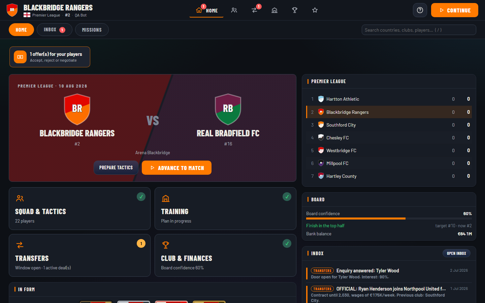
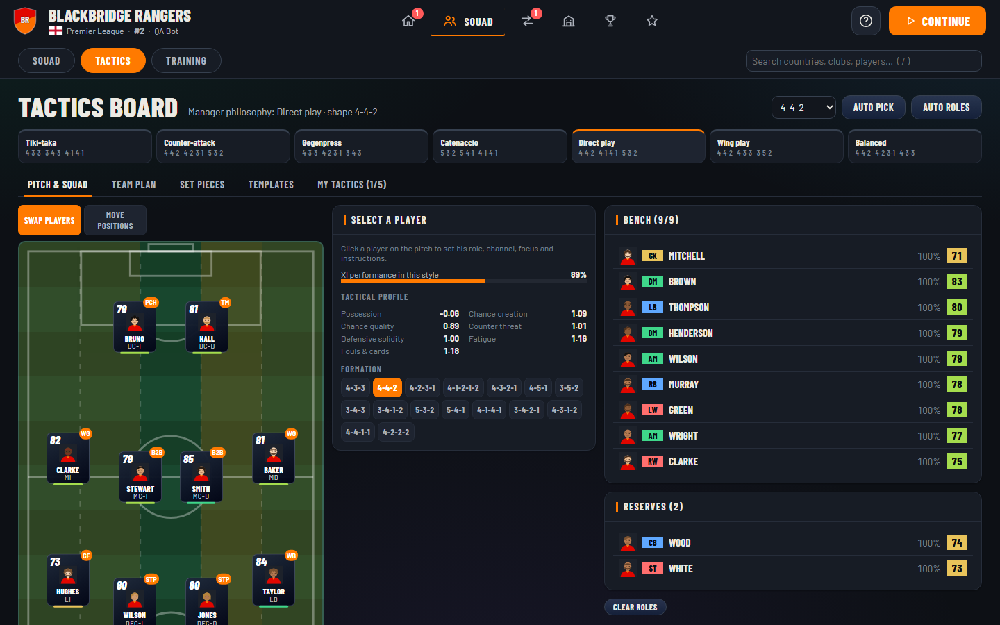
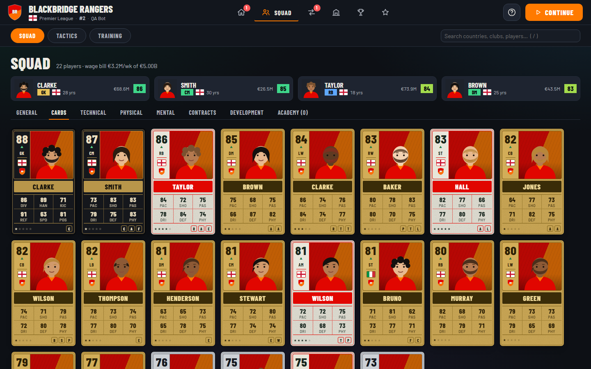
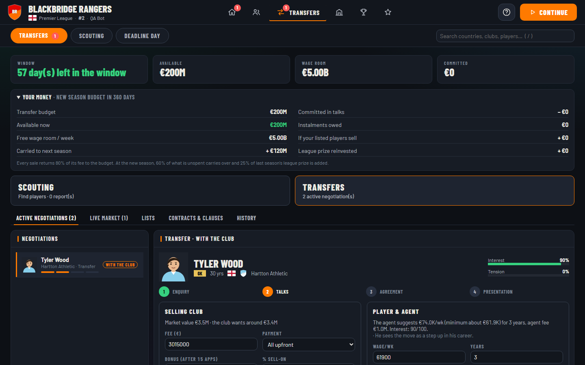
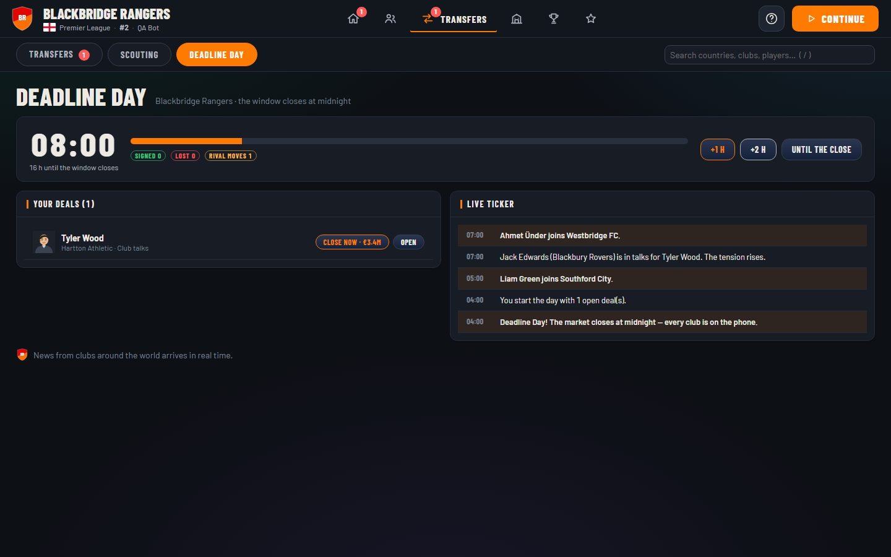
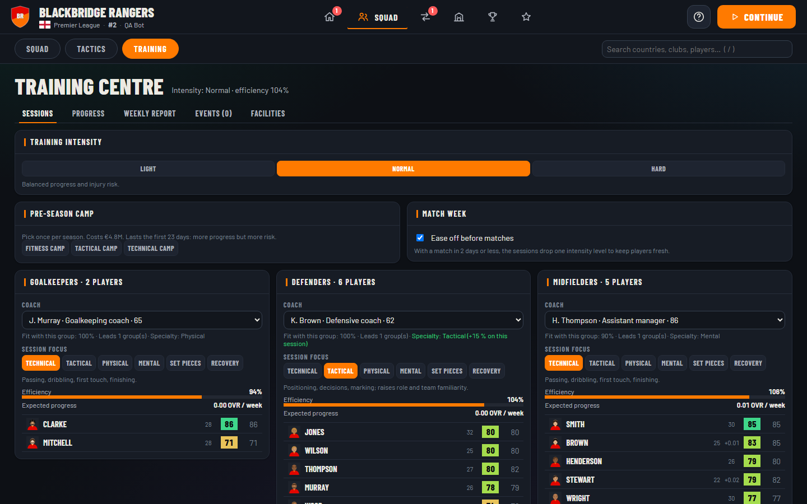
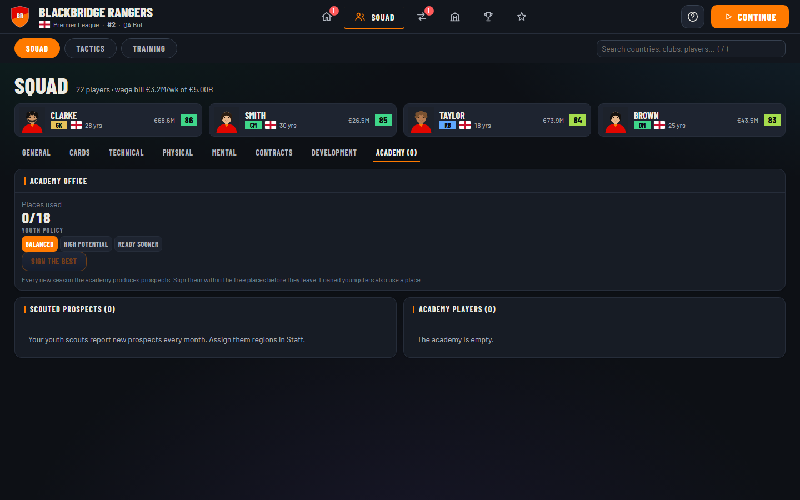
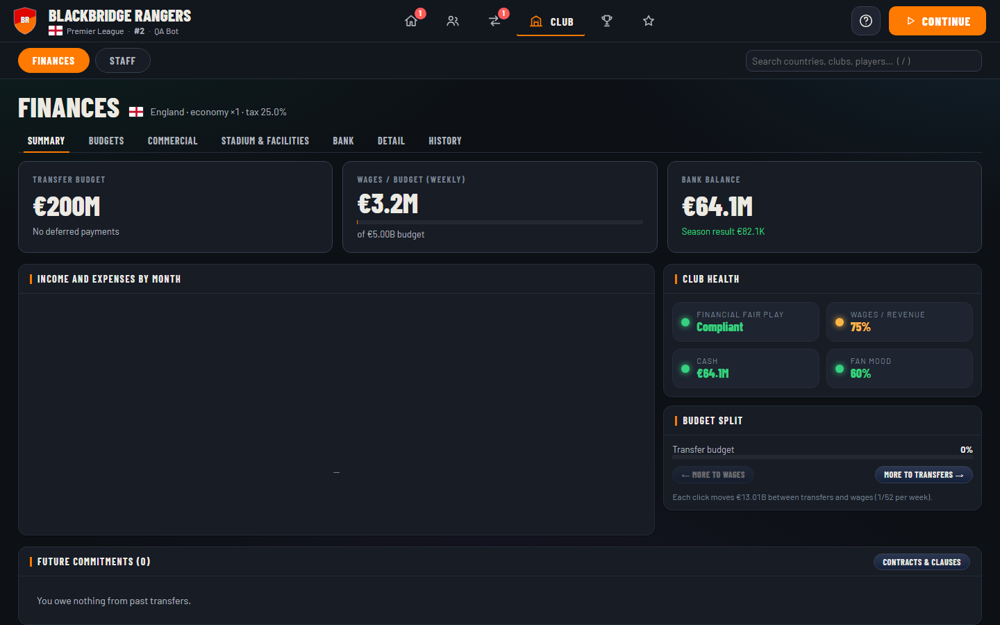

<div align="center">

# Pitchside Manager

**A deep, worldwide football-management simulator that runs entirely in your browser.**

211 national federations · full league pyramids · staged transfers · live Deadline Day · tactics board with 27 positions · youth academy · four languages

[Features](#features) · [Screenshots](#screenshots) · [Quick start](#quick-start) · [Documentation](#documentation) · [Project layout](#project-layout) · [Data & legal](#data--legal-notice)

</div>

---

Pitchside is an open-source football manager. There is **no backend**: the simulation engines are pure
TypeScript (`packages/core`) and the interface is a React + Vite single-page app (`apps/web`). Saves live
in your browser (IndexedDB, gzip-compressed), every simulation is **deterministic** (seeded RNG) and the whole
game is covered by unit and end-to-end tests.

## Screenshots

| Home | Tactics board |
| --- | --- |
|  |  |

| Squad as collector cards | Transfers with the "Your money" panel |
| --- | --- |
|  |  |

| Deadline Day, live | Training centre |
| --- | --- |
|  |  |

| Youth academy | Finances |
| --- | --- |
|  |  |

## Features

### Match day
- **Live 2D match** with both formations on the pitch, four speeds or "result only", half-time team talk,
  substitutions, mentality and saved-tactic changes mid-match, and a tactical **timeout** per half.
- **Interactive moments** (penalties, free kicks) that pause the match until you decide.
- **Match summary** with man of the match, story tags ("comeback", "thriller"…), key moments and a
  deterministic **2D replay** of every highlight.
- Weather, attendance, referees with personalities, cards, injuries and controversies.

### Tactics (V2 + V3)
- Free-form formations: drag players, or switch to *positions* mode and move any slot anywhere on the pitch.
  **27 positions** with row-based labels and **33 roles** (inverted wing-back, deep-lying playmaker, …).
- Per-player **focus, instructions, attacking channels and passing risk**; team plan (build-up style,
  defensive approach, width, depth, marking, transition, set-piece routines, captain and takers).
- Seven style presets and tactic templates, up to five saved tactics, **leading / trailing plans** that kick
  in from minute 55, and a tactical-fit meter that explains how well the XI suits the philosophy.

### Transfers (staged, FC-style)
- **Enquiry → club talks ⇄ player talks (in parallel) → agreement → presentation.** Replies take 1–3 days.
- Instalments, performance bonuses, sell-on %, buy-back clauses, scheduled entry (now / next window / next
  season), swap deals, renegotiation twists for stars, and a **director of football** who negotiates for you.
- **Scouting is never instant**: a 4-phase analysis reports estimated attributes with an error margin,
  a potential range and an estimated value. There is *no* pre-signing "good/bad deal" verdict — the mood of
  a signing only appears at the presentation.
- **Counter-offers to incoming bids** (hidden buyer ceiling, up to 3 rounds), AI swap offers and buy-backs.
- **Your money** panel (available vs. committed budget, expected sales, season carry-over) and a
  "you are short by X" assistant that lists sales, wage-to-transfer moves and instalment options.
- Selling a player returns 80 % of the fee to the transfer budget; the AI bids for the players you list.

### Deadline Day, live
The last day of every window is played **hour by hour (04:00 → 24:00)**: replies arrive within hours,
named rival managers raise prices or hijack your targets, AI clubs panic-buy in a live ticker, and you can pay
a premium to close a deal on the spot. Ends with a wrap-up and dedicated achievements.

### Player development
- **Dynamic rating** (base vs. today, driven by form, morale and fitness) and six **growth profiles**.
- **Potential is hidden**: you only see an exact value for your own players, an `x–y` range after scouting
  someone, and nothing otherwise.
- Weekly **training**: coaches per group (GK / DEF / MID / ATT / youth), session focus, intensity,
  pre-season camps, an automatic "match-week" easing, player **growth plans**, mentors, weekly events that
  ask for decisions, and a progress tab with sparklines.
- **Youth academy**: capacity from facilities, a youth policy, a yearly intake you sign as prospects,
  youth loans for minutes, and "ready to promote" hints.

### Club, finances and career
- Full ledger with budgets, FPF-style regimes per confederation, loans, sponsors, stadium, ticket prices,
  facility projects and a financial health summary. Create your own club with a crest designer.
- Board confidence, objectives, missions, manager XP, **perks tree**, season **path** rewards, achievements,
  club legends and records, unemployment/job market (there is no hard "game over" after being sacked).
- Press conferences, social media, journalists, rumours with reliability, agents and a live market.

### The world
- **211 national federations** with real league pyramids and clubs (Americas tiers follow the 2026 official
  structure), cups, continental competitions and national-team tournaments.
- Interactive world map, league tables, awards, honours and referee stats.

### Interface
- EA-style **top navigation** with six sections, flat dark design, collector-style **player cards** by rarity,
  guided tutorial and in-game glossary.
- **English, Español, Português (Brasil) and Русский** — switching language retranslates the whole history
  (news, commentary, press) because text is stored as keys + params, never as rendered strings.

## Quick start

Requirements: **Node.js 20+** and npm.

```bash
git clone https://github.com/Juannx2376/pitchside-manager.git
cd pitchside-manager
npm install
npm run dev          # http://localhost:5173
```

Useful commands (from the repo root):

| Command | What it does |
| --- | --- |
| `npm run dev` | Web dev server on port 5173 |
| `npm test` | Core unit tests (Vitest) |
| `npm run typecheck` | Strict `tsc --noEmit` for core and web (the only lint gate) |
| `npm run e2e -w @pitchside/web` | Playwright end-to-end tests (starts its own Vite on :5273) |
| `npm run build` / `npm run build:public` | Production build / build without third-party data |
| `npm run sim -- --seasons 1 --user ENG` | Headless season simulation from the CLI |

Without the optional real-world database the game starts with a **fully generated world** (names, clubs and
squads are procedural). See [docs/DATA.md](docs/DATA.md) to build or plug in your own database.

## Documentation

| Document | Contents |
| --- | --- |
| [docs/ARCHITECTURE.md](docs/ARCHITECTURE.md) | Monorepo layout, engines, state, determinism, saves, i18n, UI shell |
| [docs/GAMEPLAY.md](docs/GAMEPLAY.md) | How each system works from the player's point of view |
| [docs/DATA.md](docs/DATA.md) | Data pipeline, the optional world database and third-party data policy |
| [docs/ROADMAP.md](docs/ROADMAP.md) | Known gaps and ideas |
| [CONTRIBUTING.md](CONTRIBUTING.md) | Dev workflow, conventions and how to add features |
| [AGENTS.md](AGENTS.md) | Dense engineering notes (also used by AI coding agents) |
| [docs/design/](docs/design) | Original design documents (Tactics V2/V3 master plan, in Spanish) |

## Project layout

```text
packages/core     Pure-TS game engines (no build step; web imports the source directly)
  src/            match, tactics, transfers, finance, training, youth, scouting, i18n, …
  test/           Vitest unit tests (deterministic, seeded)
  scripts/        CLI tools: simulation, calibration, data pipeline, UI key checker
apps/web          React 18 + Vite + Zustand UI, plain CSS (no Tailwind)
  src/views/      One file per screen        src/components/   Shared widgets
  src/store/      Zustand store (the only place that mutates game state)
  e2e/            Playwright tests (tactics board, hooks, overflow audit, …)
sample-data/      Tiny synthetic CSV used by the importer test
docs/             Architecture, gameplay, data, roadmap and screenshots
```

## Tech stack

TypeScript (strict) · React 18 · Vite · Zustand · Vitest · Playwright · d3-geo / topojson (world map).
No server, no database, no analytics.

## Data & legal notice

The public repository ships **no third-party game data**: no EA SPORTS FC attributes, photos or club crests.
The optional world database (`apps/web/public/data/world-db.json`) and its raw inputs (`data/`) are excluded
and must be built locally by whoever wants them — see [docs/DATA.md](docs/DATA.md). Real club and player
names that appear in procedural or curated rosters are used for identification only.

Pitchside Manager is an independent fan project and is **not affiliated with, endorsed by or connected to**
EA SPORTS, FIFA, UEFA, any league, club or player. All trademarks belong to their respective owners.

## License

Source code is released under the [MIT License](LICENSE).
